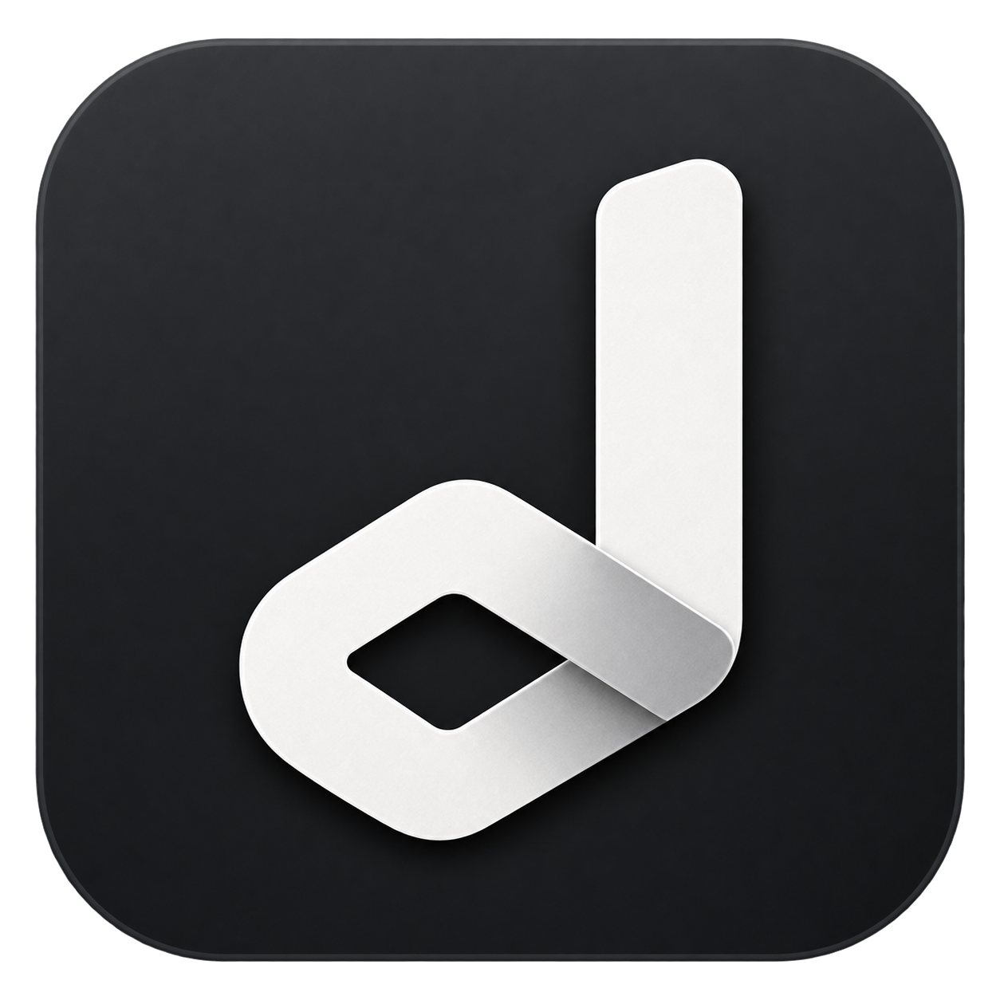

# TikTok Live Recorder

<p align="center">
  
</p>

A native desktop app for automatically recording TikTok livestreams on macOS,
Windows, and Linux. Written in Go with mygo NativeUI: no web frontend, emulator,
or running browser is needed for monitoring and recording.

## Download and open

Download the version for your operating system and processor from this repository's
**Releases** page. You do not need Go to run the app.

Releases do not use verified Apple or Windows publisher certificates, and macOS
builds are not notarized by Apple. Your computer may warn you on first launch.
Only continue if you trust the source of the download.

### macOS

1. Open the downloaded `.dmg` and drag **TikTok Live Recorder** to **Applications**.
   If you downloaded a `.zip` instead, extract it and move the app to **Applications**.
2. Try opening the app once. If macOS says the developer cannot be verified or
   Apple cannot check it, dismiss the warning.
3. Open **System Settings → Privacy & Security**, scroll to **Security**, and click
   **Open Anyway** beside the message about TikTok Live Recorder. Confirm **Open**
   and authenticate if asked.

This makes an exception for this app; do not disable Gatekeeper system-wide.
See [Apple's instructions](https://support.apple.com/en-us/102445).

### Windows

Download and run the portable `.exe`. No installation is needed. If Windows displays
**Windows protected your PC**, choose **More info → Run anyway**, if available.
An unsigned release may show **Unknown publisher**.

Some Windows security settings or work/school policies block unsigned apps
entirely. Do not turn off system-wide protections to work around that restriction.
See [Microsoft's explanation](https://learn.microsoft.com/en-us/windows/apps/package-and-deploy/smartscreen-reputation).

### Linux

On Debian/Ubuntu, install the `.deb` with your package manager. Alternatively,
extract the `.tar.gz`, open a terminal in the extracted folder, and run:

```sh
chmod +x tiktok-live-recorder
./tiktok-live-recorder
```

## Getting started

1. Open the app and choose your recording folder in **Settings**.
   If FFmpeg is missing, accept the guided setup to create MKV playback copies.
2. Click **Add streamer** and enter a username, `@username`, or a profile/live URL
   such as `https://www.tiktok.com/@username/live`.
3. Leave monitoring enabled. The app checks the queue and starts recording when
   it finds a playable live stream.

Public streams can work without an account. If TikTok requires login or limits
access, add a signed-in browser session as described below. Authentication does
not grant access to streams that your account is not permitted to watch.

## Account setup

**We strongly recommend creating a brand-new TikTok account dedicated to this
app rather than using your personal account.**

1. Sign in at [tiktok.com](https://www.tiktok.com/) in your browser.
2. Open Developer Tools → **Application → Cookies → https://www.tiktok.com**.
3. Find **sessionid** and copy its **Value**.
4. In the app, open **Settings → TikTok account**, click **Paste cookie**, then
   **Validate account** and **Save settings**.


Successful validation displays your account's name and username. If the session
expires, sign in again and copy a fresh sessionid value. Clear the field and save
to return to anonymous requests.

Cookies grant account access. They are stored locally in `config.json`, not sent
to external signing services or written to application logs. Do not share your
configuration file or paste your cookies into issue reports.

## Recordings

Every recording starts with the **original HTTP-FLV byte stream**, saved directly
to a `.flv` file. The app does not remux it, re-encode it, repair it, or rewrite
its timestamps. This preserves the source even when another container would lose
information or expose artifacts. **New installations also create a separate MKV
playback copy by default**, without re-encoding or quality loss.

- The highest-quality offered source is preferred, including HEVC. Origin
  renditions take priority; playback compatibility never causes an automatic
  downgrade to a lower-quality H.264 rendition. The stream is never re-encoded.
- Filenames start with `@username`. Streamer folders start with `@username`,
  followed by the display name. Existing files and folders are not renamed.
- Raw recording does **not** require FFmpeg.
- Files are synchronized to disk periodically and kept after interruptions.
  This reduces data loss; it cannot guarantee recovery from disk failure, power
  loss, or defects already present in the source stream.
- If the CDN connection ends, the app checks the streamer again. A reconnection
  creates a new raw file instead of concatenating or modifying FLV headers.
- The **Recordings** page shows local history and can reveal files in your file
  manager. Finalized entries disappear when both the raw file and any processed
  copy are deleted outside the app and the recording drive is available.
- Removing a streamer never deletes existing recordings.

### Playback copies and FFmpeg

**Settings → Recording → Create a processed copy with FFmpeg** is enabled by
default for new installations. After each raw recording ends, the app creates
an additional `.processed.mkv` file in the background. Saved preferences are
respected when updating. You can disable copies, choose MP4 or TS, or customize
the output options. **The original FLV is kept by default, and is always kept if
processing fails or is canceled.**

To save disk space, optionally enable **Delete original FLV after processing**
in the same section. Processing must be enabled. The app checks the entire
processed file with FFmpeg, flushes it to disk, and saves its history entry
before deleting the FLV. Failed checks, changed files, interrupted processing,
or a failure to save the playback-copy entry keep the original. Turning processing
off also turns cleanup off. This applies to new recording jobs, not existing files.

**Cleanup permanently removes the untouched source. Leave it off if you need
that source, especially when custom output options discard tracks or quality.**

If an HEVC FLV plays audio but no video in your player, an MKV copy with
`-map 0:v? -map 0:a? -c copy` preserves the codecs and quality while using a more
widely supported container. It also gives live timestamps a normal playback
timeline for seeking. The original FLV remains unchanged. Copies require roughly
as much additional disk space as their raw recordings with the default options.

When a copy is ready, the **Recordings** page shows it and uses it for **Open
recording**, **Show in folder**, and **Copy file path**. The right-click menu also
provides separate actions for the original FLV while it is retained. A recording
stays in history after automatic FLV cleanup. Until a copy is ready, or if
processing is disabled or fails, the raw file remains available.

The editable field contains **output options only**. The app chooses the input
raw file, the output path, and the FFmpeg executable; it never runs a shell.

Examples:

```text
-map 0:v? -map 0:a? -c copy
```

For an MP4 copy with fast start:

```text
-map 0:v? -map 0:a? -c copy -movflags +faststart
```

Do not enter `ffmpeg`, `-i`, input/output paths, or placeholders in this field.
Common mapping, codec, bitrate, filter, and muxing options are supported. Options
that add inputs, extra outputs, scripts, or file attachments are rejected.
Explicit `-f` overrides are limited to `matroska`, `mp4`, and `mpegts`; playlist
and multiple-file formats are not supported.

FFmpeg is discovered from PATH, a previous per-user installation, or an explicit
path chosen in Settings. Guided installation downloads a third-party build,
verifies its checksum, and installs it for your user account without administrator
access or changing PATH. It is optional for raw recording and is not bundled.

## Monitoring and priorities

Monitoring uses one globally paced polling queue. There is no native TikTok
live-start listener in this version, and the app does not automatically follow
accounts or change their notification settings.

The defaults are a 75-second normal interval, a 5-minute low-priority interval,
and at least 2 seconds between API requests. Requests can take longer; these
intervals are not guaranteed detection times. One endpoint is normally enough;
an alternative endpoint is tried if playback discovery fails.

After a media connection ends, the app briefly checks for a resumed stream about
every 5 seconds, for up to 2 minutes. The row shows **Reconnecting** during this
window. If the stream returns, recording starts in a new raw FLV; otherwise,
the configured polling interval resumes. These checks share the normal queue,
respect pauses and rate-limit backoff, and stop while a recording is active.

The **Polling queue** calculator estimates how your intervals and number of
eligible streamers affect the queue. Recorded streamers are excluded. Low-priority
streamers can be promoted automatically after recording starts. TikTok rate limits
cause a shared backoff rather than aggressive retries.

Use the row's **…** menu:

- **Pause recording:** stop/finalize the current raw file and keep checking live
  status. **Resume recording** schedules another check without deleting/re-adding
  the streamer.
- **Pause monitoring:** stop checks and any current recording for that streamer.
  **Resume monitoring** restores checks; the separate recording-pause preference
  is preserved.
- Rename the streamer or change its priority.

Disabling monitoring globally stops new checks, but does not interrupt current
recordings. Changes in Settings take effect after **Save settings**.

An access error is not treated as proof that a streamer is offline. The app shows
an attention/access status and records the reason in Logs. These are unofficial
TikTok endpoints: access rules, response formats, regions, and CDN availability
can change. An account is not a guarantee that every stream will be recordable.

## Settings and local data

Settings include appearance, the recordings folder, polling intervals, account
cookies, optional FFmpeg processing, and desktop recording-start notifications.
Notifications can be disabled and may also require OS notification permission.

The configuration directory contains:

- `config.json`: preferences and optional account cookies.
- `data.json`: streamers and recording history; no database is used.
- `tiktok-live-recorder.log`, `.log.1`, `.log.2`: rotating logs, up to approximately
  15 MB total. The UI retains up to 5,000 entries and filters before displaying
  the virtualized table, newest first.

Open this directory from Settings or Logs. Its default location is the OS user
configuration directory under `TikTok Live Recorder`:

- macOS: `~/Library/Application Support/TikTok Live Recorder`
- Windows: `%APPDATA%\TikTok Live Recorder`
- Linux: `$XDG_CONFIG_HOME/TikTok Live Recorder`, or
  `~/.config/TikTok Live Recorder` when that variable is unset.

Configuration updates are written atomically. Corrupt files are not silently
overwritten. To use another directory, pass `-config-dir /path/to/config`.

## Building from source

Requires Go 1.27.2 or later. There is no JavaScript toolchain or frontend build.

```sh
go run .
go test -race ./...
go vet ./...
go tool mygo build
```

Cross-platform packages:

```sh
go tool mygo build -platform darwin/arm64,windows/amd64,linux/amd64
```

`go run . -preview` shows synthetic sample data with monitoring and recording
disabled. Build artifacts are placed under `build/` and are not source files.

## Notice

Always obtain the streamer's consent before recording, and their permission
before sharing or publishing a recording. Respect their privacy, applicable
laws, and TikTok's terms of service.

TikTok Live Recorder is an independent project developed for educational purposes.
It is not affiliated with, sponsored by, or endorsed by TikTok or ByteDance.
Its educational purpose does not grant permission to record or redistribute
someone else's content.

## Credits

- [The Go Programming Language](https://go.dev/) — [License](https://go.dev/LICENSE)
- [mygo](https://github.com/egoist/mygo) — [EGOIST](https://github.com/egoist) and contributors — [License](https://github.com/egoist/mygo/blob/v0.6.3/LICENSE)
- [ffmpeg](https://ffmpeg.org/) — [Licensing](https://ffmpeg.org/legal.html)

See [CREDITS.md](CREDITS.md) for the included notices.

## License

[MIT](LICENSE).
